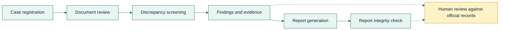
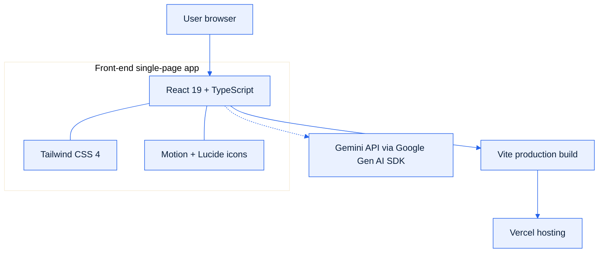

<p align="center">
  
</p>

<p align="center">
  <b>AI-Powered Land-Record Screening and Report Integrity Verification System</b><br />
  <sub>A GovTech hackathon prototype for structured, transparent, human-led land-record review in Bangladesh.</sub>
</p>

<p align="center">
  
  
  
  
</p>

<p align="center">
  <a href="https://code-nova-jomi-guard-pro.vercel.app"></a>
  <a href="https://github.com/atikrh-beep/Code-Nova_Jomi-Guard-Pro"></a>
  <a href="#getting-started"></a>
</p>

<table>
  <tr>
    <td>
      <b>Important notice</b><br />
      Jomi Guard Pro is a preliminary screening and demonstration tool. It uses <b>synthetic data</b>, is <b>not</b> an official government service, and does <b>not</b> establish legal title, ownership, or document authenticity. A flagged inconsistency is <b>not</b> evidence of fraud. See the <a href="#disclaimer">full disclaimer</a>.
    </td>
  </tr>
</table>

<p align="center">
  <a href="#overview">Overview</a> ·
  <a href="#problem-and-solution">Problem &amp; Solution</a> ·
  <a href="#features">Features</a> ·
  <a href="#how-it-works">How It Works</a> ·
  <a href="#architecture">Architecture</a> ·
  <a href="#technology-stack">Tech Stack</a> ·
  <a href="#data-and-integrity">Data &amp; Integrity</a> ·
  <a href="#responsible-ai">Responsible AI</a> ·
  <a href="#getting-started">Getting Started</a> ·
  <a href="#deployment">Deployment</a> ·
  <a href="#project-structure">Structure</a> ·
  <a href="#screenshots">Screenshots</a> ·
  <a href="#security-and-limits">Security &amp; Limits</a> ·
  <a href="#roadmap">Roadmap</a> ·
  <a href="#contributing">Contributing</a> ·
  <a href="#credits-and-license">Credits &amp; License</a> ·
  <a href="#disclaimer">Disclaimer</a> ·
  <a href="#team">Team</a>
</p>

<p align="center"></p>

<a name="overview"></a>
<p align="center"><code>01</code> &nbsp;<b>OVERVIEW</b></p>

<table>
  <tr>
    <td align="center" width="25%"><b>Domain</b><br />GovTech</td>
    <td align="center" width="25%"><b>Country</b><br />Bangladesh</td>
    <td align="center" width="25%"><b>Type</b><br />Educational prototype</td>
    <td align="center" width="25%"><b>Theme</b><br />Digital Land Records</td>
  </tr>
</table>

<p align="center">
  Jomi Guard Pro explores how a digital tool can make the <b>preliminary review</b> of land-related records more organized, transparent, and understandable. It brings review work into one interface, surfaces potential inconsistencies for human follow-up, and supports checking whether an issued report still matches a trusted integrity reference.
</p>

<p align="center"><i>The tool assists the reviewer. It never replaces official verification or legal authority.</i></p>

<p align="center"><b>Abstract</b></p>

<p align="center">
  <sub>Jomi Guard Pro is a smart land-record verification and discrepancy detection platform designed for Bangladesh. It aims to simplify preliminary land-document review by helping users identify potential inconsistencies across land-related records. Through structured validation and AI-assisted explanations, the platform seeks to make document checking more understandable, efficient, and transparent. The prototype demonstrates land-record screening using synthetic data, with findings requiring verification against authentic official records.</sub>
</p>

<a name="problem-and-solution"></a>
<p align="center"><code>02</code> &nbsp;<b>PROBLEM &amp; SOLUTION</b></p>

<table>
  <tr>
    <td width="50%" valign="top">
      <b>The problem</b><br /><br />
      Reviewing several land-related documents is complicated and time-consuming.<br /><br />
      • Owner names, plot numbers, khatian numbers, deed references, and land measurements can be hard to compare by hand.<br />
      • Missing or conflicting details cause confusion and extra verification work.<br />
      • Citizens benefit from tools that explain <i>what</i> looks inconsistent and <i>why</i> before relying on a document.<br /><br />
      <sub>No claims are made about fraud rates, financial losses, or the number of people affected.</sub>
    </td>
    <td width="50%" valign="top">
      <b>The proposed solution</b><br /><br />
      A clear, accessible workspace that:<br /><br />
      • Organizes land cases in a structured workflow.<br />
      • Screens records for <b>potential</b> inconsistencies.<br />
      • Explains flagged items in plain language.<br />
      • Supports hash-based report integrity checks.<br />
      • Directs users back to official documents and authorized land offices.<br /><br />
      <sub>Objective: make preliminary screening structured, traceable, and accessible, with humans in charge.</sub>
    </td>
  </tr>
</table>

<a name="features"></a>
<p align="center"><code>03</code> &nbsp;<b>FEATURES</b></p>

<p align="center">
  <sub>The project's public site describes a platform for land-record screening, discrepancy detection, evidence management, audit reporting, and public report-integrity verification.</sub>
</p>

<table>
  <tr>
    <td width="50%" valign="top"><b>Land-case management</b><br />Organize cases and related information.<br /><sub>Status: described by the project</sub></td>
    <td width="50%" valign="top"><b>Document review</b><br />Support preliminary review of record information.<br /><sub>Status: described by the project</sub></td>
  </tr>
  <tr>
    <td valign="top"><b>Discrepancy screening</b><br />Flag potential inconsistencies between fields.<br /><sub>Status: described by the project</sub></td>
    <td valign="top"><b>Evidence and findings</b><br />Structure notes and supporting information.<br /><sub>Status: described by the project</sub></td>
  </tr>
  <tr>
    <td valign="top"><b>Audit reporting</b><br />Present review results in a consistent format.<br /><sub>Status: described by the project</sub></td>
    <td valign="top"><b>Activity tracking</b><br />Keep a history of case actions.<br /><sub>Status: described by the project</sub></td>
  </tr>
  <tr>
    <td valign="top"><b>Report integrity verification</b><br />Compare a report hash with a trusted reference.<br /><sub>Status: described by the project</sub></td>
    <td valign="top"><b>AI-assisted explanations</b><br />Explain findings through the Gemini API.<br /><sub>Status: dependency present; runtime use to be confirmed</sub></td>
  </tr>
</table>

<p align="center">
  <sub>Status labels reflect the repository configuration and the deployed site's description. Update them (implemented, partial, planned) after reviewing <code>src/</code>, and only present a feature as working once it has been demonstrated.</sub>
</p>

<a name="how-it-works"></a>
<p align="center"><code>04</code> &nbsp;<b>HOW IT WORKS</b></p>

<p align="center"><sub>Intended review journey. This is a conceptual overview, not a claim that every stage is fully automated.</sub></p>



<p align="center"><sub>Dashed arrows mark where human review and official verification must happen. A potential discrepancy is a prompt to look closer, not a conclusion.</sub></p>

<a name="architecture"></a>
<p align="center"><code>05</code> &nbsp;<b>ARCHITECTURE</b></p>

<p align="center"><sub>Solid items are confirmed from the repository configuration. The dashed AI link should be confirmed in the source.</sub></p>



<p align="center"><sub>Express and dotenv are listed as dependencies, but no operational backend is documented and <code>package.json</code> has no start script for one.</sub></p>

<a name="technology-stack"></a>
<p align="center"><code>06</code> &nbsp;<b>TECHNOLOGY STACK</b></p>

<p align="center">
  
</p>

| Technology | Role in the project |
| --- | --- |
| **React 19** | Component-based user interface |
| **TypeScript** | Typed code; `npm run lint` runs `tsc --noEmit` |
| **Vite 8** | Dev server and production build |
| **Tailwind CSS 4** | Utility-first styling via `@tailwindcss/vite` |
| **Motion** | Interface animation |
| **Lucide React** | Icon set |
| **Google Gen AI SDK** | Gemini API client, listed as a dependency |
| **Express, dotenv** | In dependencies; not described as an active backend |
| **Vercel** | Hosting for the deployed demo |

<a name="data-and-integrity"></a>
<p align="center"><code>07</code> &nbsp;<b>DATA &amp; INTEGRITY</b></p>

<table>
  <tr>
    <td>
      <b>The prototype uses synthetic, simulated data.</b><br />
      Names, plot numbers, khatian numbers, deed references, ownership details, and measurements are fictional and must never be represented as authentic government data. Demonstration identifiers such as <code>RS-DEMO-101</code>, <code>CS-DEMO-075</code>, and plot <code>8-9-2</code> are illustrative only. No live integration with any Bangladesh government land-record database is confirmed, and no official API access, partnership, or private citizen data is claimed.
    </td>
  </tr>
</table>

**Reference portals** (context only; Jomi Guard Pro does not download data from them):

| Source | Relevance |
| --- | --- |
| [Department of Land Records and Surveys](https://dlrs.gov.bd/) | Land-record and survey information |
| [Khatian search](https://settlement.gov.bd/Khatian/) | Public khatian search interface |
| [Bangladesh Land Portal](https://www.land.gov.bd/) | Government land-service information |

<details>
<summary><b>Understanding report integrity</b></summary>

<br />

A cryptographic hash such as SHA-256 can show that a report file matches a previously recorded reference. A matching hash does **not** prove legal validity, factual accuracy, the issuer's authority, property ownership, or the authenticity of the reference hash itself. Reliability depends on how the reference was created, protected, and verified.

</details>

<a name="responsible-ai"></a>
<p align="center"><code>08</code> &nbsp;<b>RESPONSIBLE AI</b></p>

<table>
  <tr>
    <td width="50%" valign="top">
      <b>Development tools</b><br /><br />
      • <b>Google AI Studio</b>: AI-assisted development; the repository was generated from Google's AI Studio template.<br />
      • <b>ChatGPT</b>: planning, debugging guidance, documentation help.<br />
      • <b>Claude</b>: README drafting.<br /><br />
      <sub>These helped build the project. They are not claimed to run inside the deployed app.</sub>
    </td>
    <td width="50%" valign="top">
      <b>Runtime AI</b><br /><br />
      The Google Gen AI SDK is a dependency and <code>.env.example</code> expects a <code>GEMINI_API_KEY</code>. Whether AI explanations are active in the deployed demo should be confirmed from the source before describing them as live.<br /><br />
      <b>Principles</b><br />
      • AI output can be wrong; a person must review it.<br />
      • Discrepancies are not proof of fraud.<br />
      • Keys must never be exposed client-side.
    </td>
  </tr>
</table>

<a name="getting-started"></a>
<p align="center"><code>09</code> &nbsp;<b>GETTING STARTED</b></p>

<p align="center"><sub>Requires <a href="https://nodejs.org/">Node.js</a> 20.19.0 or newer, npm, and <a href="https://git-scm.com/">Git</a>.</sub></p>

```bash
git clone https://github.com/atikrh-beep/Code-Nova_Jomi-Guard-Pro.git
cd Code-Nova_Jomi-Guard-Pro
npm install
npm run dev
```

<p align="center">Then open <a href="http://localhost:3000"><b>http://localhost:3000</b></a> (the dev script serves on port 3000).</p>

<details>
<summary><b>Environment variables</b></summary>

<br />

The repository includes a `.env.example` with two variables:

| Variable | Purpose |
| --- | --- |
| `GEMINI_API_KEY` | Gemini API key for AI features |
| `APP_URL` | URL where the app is hosted |

```bash
cp .env.example .env.local
# edit .env.local with your own values
```

**Security:** never commit real keys. Vite exposes only `VITE_`-prefixed variables to browser code, and anything shipped to the browser is public. The current `vite.config.ts` does not inject `GEMINI_API_KEY` into client code. For real deployments, keep the key behind a server-side function or proxy.

</details>

<details>
<summary><b>All commands</b></summary>

<br />

| Command | What it does |
| --- | --- |
| `npm run dev` | Start the dev server on port 3000 |
| `npm run build` | Create a production build in `dist/` |
| `npm run preview` | Preview the production build locally |
| `npm run lint` | Type-check with `tsc --noEmit` |
| `npm run clean` | Remove `dist` and `server.js` (needs a Unix-like shell) |

</details>

<a name="deployment"></a>
<p align="center"><code>10</code> &nbsp;<b>DEPLOYMENT</b></p>

<p align="center">
  The demo is hosted on <b>Vercel</b> at <a href="https://code-nova-jomi-guard-pro.vercel.app">code-nova-jomi-guard-pro.vercel.app</a>. Vite builds a static front end, so the standard settings apply: build command <code>npm run build</code>, output directory <code>dist</code>. Set environment variables in the Vercel project settings, never in the repository.
</p>

<a name="project-structure"></a>
<p align="center"><code>11</code> &nbsp;<b>PROJECT STRUCTURE</b></p>

<details>
<summary><b>Confirmed root files</b></summary>

```text
Code-Nova_Jomi-Guard-Pro/
├── src/                # Application source code
├── .env.example        # Environment variable template
├── .gitignore
├── README.md
├── bun.lock
├── index.html          # Vite entry HTML
├── metadata.json
├── package-lock.json
├── package.json        # Scripts and dependencies
├── tsconfig.json
└── vite.config.ts      # Vite + React + Tailwind configuration
```

Add a tree of `src/` here once the folder layout is final.

</details>

<a name="screenshots"></a>
<p align="center"><code>12</code> &nbsp;<b>SCREENSHOTS</b></p>

<p align="center">
  Try the live demo: <a href="https://code-nova-jomi-guard-pro.vercel.app"><b>code-nova-jomi-guard-pro.vercel.app</b></a><br />
  <sub>Screenshots have not been added yet.</sub>
</p>

<details>
<summary><b>How to add screenshots</b></summary>

<br />

Save images in `docs/screenshots/` (for example `homepage.png`, `verification-workflow.png`, `results.png`), commit them, then reference them here:

```markdown

```

</details>

<a name="security-and-limits"></a>
<p align="center"><code>13</code> &nbsp;<b>SECURITY, PRIVACY &amp; LIMITS</b></p>

<table>
  <tr>
    <td width="50%" valign="top">
      <b>Security and legal boundaries</b><br /><br />
      • Output does not establish legal title or conclusively verify ownership.<br />
      • A flagged inconsistency does not establish fraud.<br />
      • Consult authentic documents and authorized land offices for important decisions.<br />
      • Do not upload sensitive personal or property data to an untrusted environment.<br />
      • Protect API keys; never commit them or place them in client code.<br />
      • Data handling and retention claims must match the confirmed implementation.<br />
      • Not claimed to be fully secure, certified, government-approved, or production-ready.
    </td>
    <td width="50%" valign="top">
      <b>Current limitations</b><br /><br />
      • Synthetic data only; no confirmed integration with official systems.<br />
      • Screening and AI explanations are preliminary and may be wrong.<br />
      • No documented backend, database, authentication, or OCR in the confirmed architecture.<br />
      • No automated tests documented.<br />
      • No security audit, usability study, or legal review yet.
    </td>
  </tr>
</table>

<a name="roadmap"></a>
<p align="center"><code>14</code> &nbsp;<b>ROADMAP &amp; IMPACT</b></p>

<p align="center"><sub>Proposed improvements, not existing features.</sub></p>

<table>
  <tr>
    <td width="50%" valign="top">
      • Authorized integration with official digital land-record services<br />
      • Better document extraction and visual discrepancy highlighting<br />
      • Stronger integrity-reference storage and digital signatures
    </td>
    <td width="50%" valign="top">
      • More comprehensive, tamper-resistant audit trails<br />
      • Bangla and English language support<br />
      • Accessibility, security, and usability testing
    </td>
  </tr>
</table>

<p align="center"><sub>Intended impact: with further development and proper authorization, tools like this could help reviewers organize their work and help citizens spot potential inconsistencies earlier. No measured impact is claimed.</sub></p>

<a name="contributing"></a>
<p align="center"><code>15</code> &nbsp;<b>CONTRIBUTING</b></p>

<p align="center">Contributions that improve clarity, accessibility, documentation, and responsible design are welcome.</p>

```bash
git checkout -b feature/your-change
npm run lint && npm run build
git commit -m "Describe your change"
```

<p align="center"><sub>Then open a pull request explaining what changed and why. Use only synthetic or properly authorized data in issues, screenshots, and pull requests. Never post real land records or personal information.</sub></p>

<a name="credits-and-license"></a>
<p align="center"><code>16</code> &nbsp;<b>CREDITS &amp; LICENSE</b></p>

<p align="center">
  <a href="https://github.com/facebook/react">React</a> ·
  <a href="https://github.com/microsoft/TypeScript">TypeScript</a> ·
  <a href="https://github.com/vitejs/vite">Vite</a> ·
  <a href="https://github.com/tailwindlabs/tailwindcss">Tailwind CSS</a> ·
  <a href="https://github.com/lucide-icons/lucide">Lucide</a> ·
  <a href="https://github.com/motiondivision/motion">Motion</a> ·
  <a href="https://github.com/expressjs/express">Express</a> ·
  <a href="https://github.com/motdotla/dotenv">dotenv</a> ·
  <a href="https://github.com/googleapis/js-genai">Google Gen AI SDK</a>
</p>

<p align="center">
  <sub>Each project is governed by its own license; see the respective repositories. Generated from <a href="https://github.com/google-gemini/aistudio-repository-template">google-gemini/aistudio-repository-template</a>.</sub>
</p>

<p align="center">
  <b>License:</b> this repository currently has <b>no explicit open-source license</b>. Until one is added, all rights are reserved by the authors by default. Add a <code>LICENSE</code> file to grant specific permissions.
</p>

<a name="disclaimer"></a>
<p align="center"><code>17</code> &nbsp;<b>DISCLAIMER</b></p>

<table>
  <tr>
    <td>
      Jomi Guard Pro is an educational hackathon prototype. It is <b>not</b> an official Bangladesh government service and does not independently establish land ownership, legal status, document authenticity, or legal validity. All findings are preliminary and must be reviewed against authentic records by authorized people. The application must not be used as a substitute for official verification, professional legal advice, or decisions by authorized government authorities.
    </td>
  </tr>
</table>

<a name="team"></a>
<p align="center"><code>18</code> &nbsp;<b>TEAM &amp; LINKS</b></p>

<table>
  <tr>
    <td align="center" width="33%"><b>Developer</b><br />Atikur Rahman and Team<br /><sub>[ADD TEAM MEMBER NAMES]</sub></td>
    <td align="center" width="33%"><b>Department</b><br />Computer Science and Engineering<br /><sub>Daffodil International University</sub></td>
    <td align="center" width="33%"><b>Theme</b><br />Digital Land Records, Verification &amp; Digitization</td>
  </tr>
</table>

<p align="center">
  <a href="https://code-nova-jomi-guard-pro.vercel.app"></a>
  <a href="https://github.com/atikrh-beep/Code-Nova_Jomi-Guard-Pro"></a>
</p>

<p align="center">
  
</p>

<p align="center">
  <sub>Built for the <b>Digital Land Records, Verification &amp; Digitization</b> hackathon theme.<br />Exploring more structured and transparent land-record review, with humans in charge.</sub>
</p>
